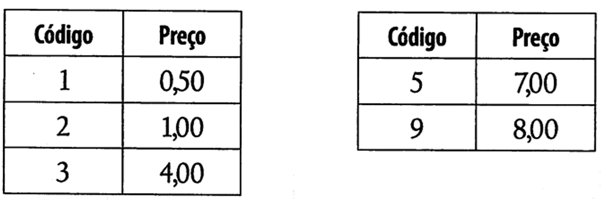

# Exercício de Revisão para a Prova

### Escreva um programa para controlar uma pequena máquina registradora. Você deve solicitar ao usuário que digite o código do produto e a quantidade comprada. Utilize a tabela de códigos a seguir para obter o preço de cada produto: 

### Seu programa deve exibir o total das compras depois que o usuário digitar 0. Qualquer outro código deve gerar a mensagem de erro "Código inválido". 

